

<a href="https://h-rasool.github.io">
  
</a>

 

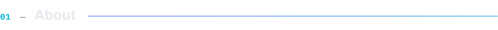
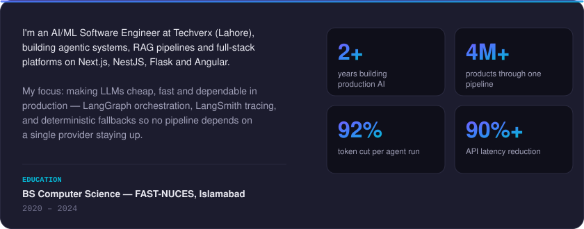

 

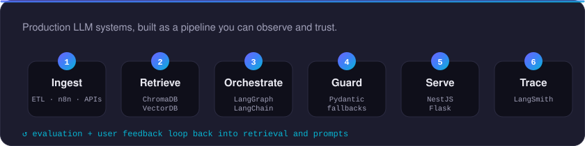

 

<table>
  <tr>
    <td width="50%"><a href="https://h-rasool.github.io/#experience">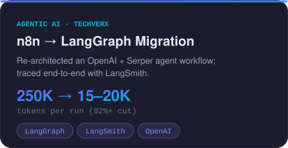</a></td>
    <td width="50%"><a href="https://h-rasool.github.io/#experience">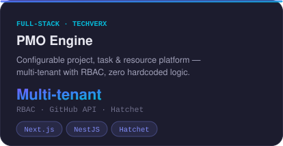</a></td>
  </tr>
  <tr>
    <td width="50%"><a href="https://h-rasool.github.io/#experience">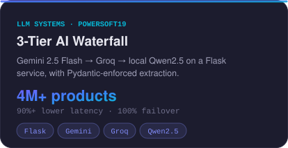</a></td>
    <td width="50%"><a href="https://github.com/H-rasool/time-series-visiualization-tool">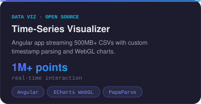</a></td>
  </tr>
  <tr>
    <td width="50%"><a href="https://github.com/H-rasool/EngineerBot">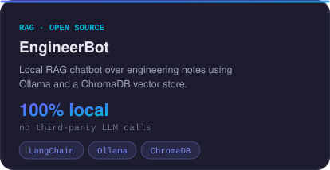</a></td>
    <td width="50%"><a href="https://github.com/H-rasool/EvolutionAPI-n8n">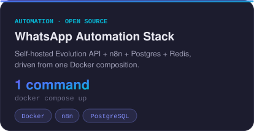</a></td>
  </tr>
</table>

Client and employer work is described on the <a href="https://h-rasool.github.io/#experience">portfolio</a>; open-source projects link straight to their repos.

 

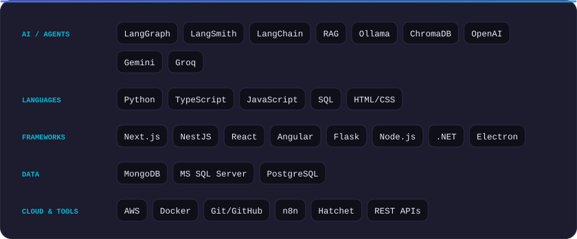

  <b>Certifications</b> &nbsp;·&nbsp; AWS Academy Graduate — Microservices &amp; CI/CD &nbsp;·&nbsp; freeCodeCamp — JavaScript Algorithms &amp; Data Structures &nbsp;·&nbsp; DataCamp — Introduction to Python &nbsp;·&nbsp; W3Schools — HTML &amp; CSS

 

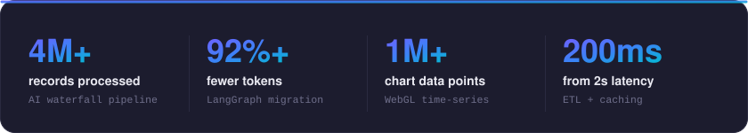

 

